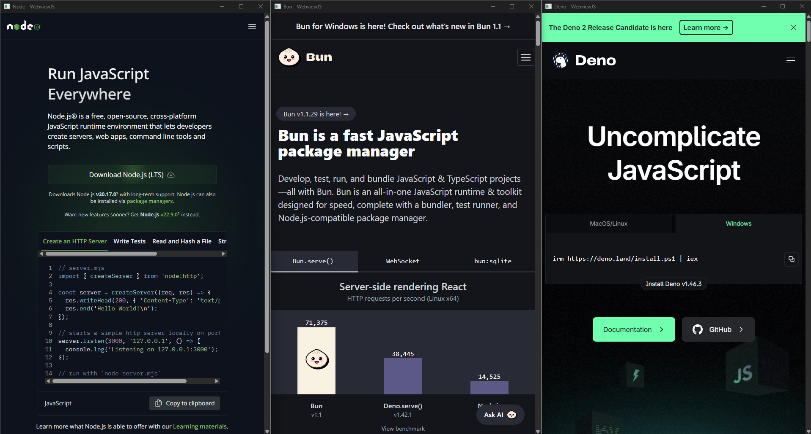

# Webview Examples

This repository contains examples of how to use the `@webviewjs/webview` crate to create a simple webview application in JavaScript.

## Preview

## Examples

See the [src](./src) directory for examples.
